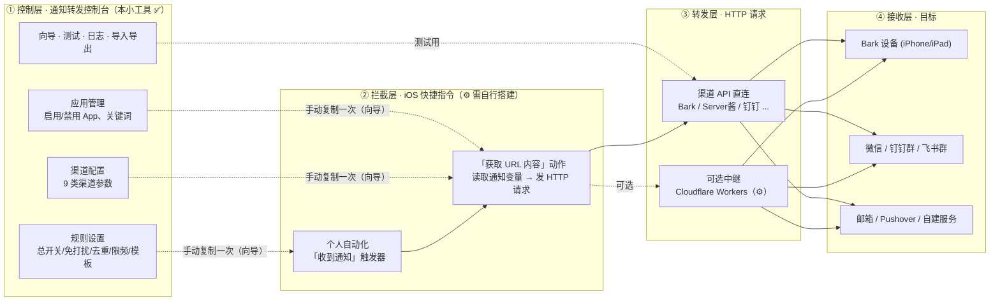

# 通知转发控制台 · 完整方案（可移植版）

> 本文基于对 `~/apps/notify-relay/` 现有源码的逐行阅读撰写，力求与实现一致。
>
> 文中标记约定：
>
> - ✅ **【已实现】**：指本小工具（纯前端 React/WebKit 应用，`通知转发`）里已经写好、可直接使用的功能。
> - ⚙️ **【需自行搭建】**：指需要你在 iOS 快捷指令、Android 自动化工具或云服务器上动手配置的部分；本小工具只负责生成参数、测试与备份，不会也不无法替你完成。
>
> 一句话结论：** iOS 的风控机制决定了没有任何普通 App 能读到别的 App 的通知。本工具是「配置控制台」，不是「拦截器」。真正的拦截转发靠 iOS 快捷指令的个人自动化在后台完成。**

---

## 1. 方案概述

### 1.1 目标

把指定 App（微信、短信、日历……）的通知，自动转发到你拥有的其他设备或群里：iPhone / iPad（Bark）、微信（Server酱）、PushPlus、企业微信群、钉钉群、飞书群、Pushover、邮箱、以及任意自定义 Webhook。

同时提供一个**配置控制台**：集中管理「哪些 App → 哪些渠道 → 遵守什么规则」，并能一键生成快捷指令参数、测试发送、查看日志、导入导出配置。

### 1.2 核心约束（为什么必须这么做）

| 事实 | 说明 |
| --- | --- |
| iOS 沙盒隔离 | 普通 App **无法读取其他 App 的通知内容**，这不是权限申请能绕过的，App Store 审核也禁止此类行为。 |
| 唯一合法的自动入口 | iOS 快捷指令的「**收到通知时**」个人自动化 + 「**获取 URL 内容**」动作，可在系统层读取该自动化的通知变量并发起 HTTP 请求。 |
| 本工具的定位 | 只做**配置生成 / 测试 / 记录 / 备份**。配置结果**不会**自动写入 iOS，需要你按「向导」把请求复制进快捷指令一次。 |

> 源码证据（`App.jsx` 设置页关于文案）：「iOS 不允许普通 App 读取其他 App 的通知。本工具负责配置与测试，自动转发需按「向导」在快捷指令中设置一次。」

### 1.3 四层架构



**关键理解**：控制层（本工具）**不在运行时链路上**。真正收到通知时的链路只有：

```
某 App 来通知
   → iOS「收到通知」自动化触发（系统读取通知变量）
   → 快捷指令「获取 URL 内容」按你复制进去的 URL/方法/请求体发出请求
   → 渠道 API 把消息投递到目标设备/群
```

### 1.4 设计原则

- **配置与执行解耦**：控制台只产出请求模板；执行交给系统级快捷指令。
- **默认安全**：密钥只存在本机 `localStorage`，导出文件可不含日志；不上传任何数据。
- **多渠道扇出**：一个 App 可对应多个渠道；快捷指令里为每个渠道加一条「获取 URL 内容」即可实现扇出。
- **规则前置**：总开关、免打扰、关键词、限频、去重在 `checkRules` 中统一判定（服务端中继可选复用同一套逻辑）。

---

## 2. 功能矩阵（✅ 已实现功能清单）

应用共 5 个主标签页（概览 / 应用 / 渠道 / 规则 / 向导）+ 1 个设置抽屉，全部已在源码中实现。

| 模块 | 功能 | 状态 | 源码位置 |
| --- | --- | --- | --- |
| **应用管理** | 从 14 个预设 App（微信、短信、电话、QQ、钉钉、企业微信、支付宝、淘宝、京东、邮件、日历、提醒事项、飞书、GitHub）快速添加 | ✅ | `lib/store.js` `PRESET_APPS`、`components/Apps.jsx` |
| | 自定义 App（名称 + emoji 图标）、搜索、编辑、删除、启用/禁用 | ✅ | `components/Apps.jsx` |
| | 每个 App 独立指定目标渠道（`channelIds`），为空表示发往全部启用渠道 | ✅ | `Apps.jsx`、`lib/shortcuts.js` `buildSetup` |
| | 关键词 `include`（白名单）/ `exclude`（黑名单），大小写不敏感 | ✅ | `Apps.jsx`、`lib/rules.js` |
| **渠道管理** | 9 类渠道：Bark、Server酱、PushPlus、企业微信、钉钉（含加签）、飞书、Pushover、邮件（Resend/SendGrid）、自定义 Webhook | ✅ | `lib/channels.js` `CHANNEL_DEFS` |
| | 渠道增删改、启用/禁用、逐渠道「测试发送」、复制请求文本 | ✅ | `components/Channels.jsx` |
| **规则** | 转发总开关 `master` | ✅ | `lib/rules.js` `checkRules`、`components/Rules.jsx` |
| | 免打扰时段（支持跨午夜，如 23:00→07:00） | ✅ | `inQuiet()` |
| | 相同内容去重窗口（秒） | ✅ | `checkRules()` |
| | 每分钟频率上限 | ✅ | `checkRules()` |
| | 标题/正文模板（`{{app}} {{title}} {{body}} {{time}}`） | ✅ | `renderPayload()` |
| **向导** | 5 步图文说明（创建自动化→选触发器→加动作→替换变量→立即运行） | ✅ | `lib/shortcuts.js` `STEPS`、`components/Setup.jsx` |
| | 按「App × 渠道」批量生成请求模板（可直接复制） | ✅ | `buildSetup()` + `buildTemplate()` |
| **测试** | 快速测试发送：选 App、填标题/正文、选渠道（全部或单个）、可选「套用规则」 | ✅ | `components/TestSheet.jsx` |
| | 发送结果显示（成功/失败/被拦截原因）、显示实际请求、记录写入日志 | ✅ | `TestSheet.jsx`、`Overview.jsx` |
| **记录** | 最近记录列表、今日成功数统计、启用应用/渠道数统计、清空记录 | ✅ | `components/Overview.jsx`、`App.jsx` |
| | 日志上限 500 条（`slice(0,500)`） | ✅ | `App.jsx`、`store.js` `normalize` |
| **备份/迁移** | 导出 JSON（自动剔除 logs）、导入 JSON（校验并规范化）、清空全部配置 | ✅ | `store.js` `exportConfig/importConfig`、`App.jsx` |
| **外观** | 主题：跟随系统 / 浅色 / 深色 | ✅ | `App.jsx`、`style.css` |
| iOS 自动化真正落地 | 在「快捷指令」里创建并授权自动化 | ⚙️ 需自行搭建 | 按本工具「向导」操作 |
| Android 自动化 | Tasker / MacroDroid + AutoNotification 拦截 | ⚙️ 需自行搭建 | 见 §6.2 |
| 服务端中继 | Cloudflare Workers 扇出 + 服务端规则 | ⚙️ 需自行搭建 | 见 §6.4 |

---

## 3. 数据模型

### 3.1 存储位置与版本

- 存储键：`localStorage['notifyrelay.v1']`（`store.js` 中 `KEY`）。
- 版本：`VERSION = 1`（写入每条配置的 `version` 字段）。
- 每次 `state` 变化自动 `save()` 写回；写入失败会 Toast 提示「本地存储写入失败，请导出备份」。
- 数据仅存本机浏览器存储，**不上传**（设置页「关于」已明确说明）。

### 3.2 完整默认结构（`defaults()`）

```json
{
  "version": 1,
  "channels": [],
  "apps": [],
  "rules": {
    "master": true,
    "quietHours": { "enabled": false, "start": "23:00", "end": "07:00" },
    "dedupeSeconds": 30,
    "ratePerMinute": 20,
    "titleTemplate": "{{app}}",
    "bodyTemplate": "{{title}} {{body}}"
  },
  "logs": [],
  "settings": { "theme": "system" }
}
```

### 3.3 字段说明

**顶层**

| 字段 | 类型 | 说明 |
| --- | --- | --- |
| `version` | number | 配置格式版本，当前为 `1`。 |
| `channels` | Channel[] | 渠道列表。 |
| `apps` | App[] | 应用列表。 |
| `rules` | object | 全局转发规则，见下表。 |
| `logs` | Log[] | 发送记录，最多 500 条；导出时被清空。 |
| `settings` | object | 界面设置，当前只有 `theme`（`system`/`light`/`dark`）。 |

**App 对象**（`Apps.jsx` 中 `openNew`）

| 字段 | 类型 | 说明 |
| --- | --- | --- |
| `id` | string | `uid()` 生成的唯一 ID。 |
| `name` | string | 应用名称，匹配通知里的 App 名。 |
| `icon` | string | emoji 图标，默认 `🔔`。 |
| `enabled` | boolean | 是否启用；`false` 时 `checkRules` 拒绝。 |
| `channelIds` | string[] | 目标渠道 ID 列表；**空数组表示发往全部启用渠道**。 |
| `keywords.include` | string[] | 包含关键词白名单：非空且未命中 → 拒绝。 |
| `keywords.exclude` | string[] | 排除关键词黑名单：命中任一 → 拒绝。 |

**Channel 对象**（`makeChannel`）

| 字段 | 类型 | 说明 |
| --- | --- | --- |
| `id` | string | `uid()` 生成。 |
| `type` | string | 9 类之一：`bark`/`serverchan`/`pushplus`/`wecom`/`dingtalk`/`feishu`/`pushover`/`email`/`webhook`。 |
| `name` | string | 显示名称，默认取渠道 label。 |
| `enabled` | boolean | 默认 `true`。 |
| `config` | object | 各渠道专属参数，见 §4 各渠道字段表。 |

**Rules 对象**

| 字段 | 默认 | 说明 |
| --- | --- | --- |
| `master` | `true` | 转发总开关，`false` 时全部拦截。 |
| `quietHours.enabled` | `false` | 免打扰开关。 |
| `quietHours.start` / `end` | `23:00` / `07:00` | 时段（24h）；`start > end` 表示跨午夜。 |
| `dedupeSeconds` | `30` | 相同 `app+title+body` 在此秒数内不重复转发；`0` 关闭。 |
| `ratePerMinute` | `20` | 最近 60 秒内记录数达到该值即限流；`0` 关闭。 |
| `titleTemplate` | `{{app}}` | 标题模板。 |
| `bodyTemplate` | `{{title}} {{body}}` | 正文模板。 |

模板可用变量（`applyTemplate` / `renderPayload`）：`{{app}}`、`{{title}}`、`{{body}}`、`{{time}}`、`{{channel}}`（`channel` 仅渠道模板可用，值为渠道名）。

**Log 对象**（`App.jsx` `addLogs`）

| 字段 | 说明 |
| --- | --- |
| `id` | `uid()` 生成。 |
| `time` | `Date.now()` 毫秒时间戳。 |
| `app` / `title` / `body` | 本次转发内容。 |
| `status` | `ok` / `fail` 等状态（用于今日成功统计）。 |
| 其他 | 错误信息、渠道摘要等。 |

### 3.4 版本与迁移策略

当前 `VERSION=1`，尚无历史版本。设计上通过 `normalize(p)` 实现**宽容式迁移**：

1. 非对象或空输入 → 返回 `defaults()`。
2. `channels`：仅保留同时含 `type` 与 `id` 的项，缺失 `config` 补 `{}`。
3. `apps`：仅保留含 `id` 与 `name` 的项，`channelIds` 非数组补 `[]`，`keywords` 补 `{ include: [], exclude: [] }`。
4. `rules`：用 `defaults().rules` 浅合并后再深合并 `quietHours`，**新增字段自动获得默认值**——这是向后兼容的关键。
5. `logs`：非数组丢弃，数组截断到前 500 条。
6. `settings`：用默认值补齐。

> 迁移准则：未来若升级到 `VERSION=2`，应在 `normalize` 中按 `p.version` 分支补字段/改结构，并保留「未知版本按 v1 宽容读取」的兜底，避免旧配置导入失败。

**导入导出行为**：

- `exportConfig(state)` → `JSON.stringify({ ...state, logs: [] }, null, 2)`，**导出时丢弃日志**。
- `importConfig(text)` → `JSON.parse` → `normalize` → 清空 `logs`；若既无 `channels` 又无 `apps` 数组则抛错「文件里没有可识别的应用或渠道配置」。

---

## 4. 渠道 API 详解

以下 9 类渠道均来自 `lib/channels.js` 的 `buildRequest()`，URL、方法、请求头、请求体与源码逐条对应。**示例中的 `{{app}}` 等占位符在快捷指令里要替换为通知变量**（见 §5.2）。

### 4.0 总览

| # | 渠道 | 方法 | 关键 URL | 请求体格式 | 浏览器内直发 | 成功判定 |
| --- | --- | --- | --- | --- | --- | --- |
| 1 | Bark | GET | `https://api.day.app/<key>/<标题>/<正文>` | 无（路径参数） | ✅ no-cors | 不透明响应，须到设备确认 |
| 2 | Server酱 | POST | `https://sctapi.ftqq.com/<SendKey>.send` | 表单 | ✅ no-cors | 不透明响应 |
| 3 | PushPlus | POST | `https://www.pushplus.plus/send` | JSON | ❌ 需复制到快捷指令 | `errcode==0` / HTTP 2xx |
| 4 | 企业微信 | POST | `https://qyapi.weixin.qq.com/cgi-bin/webhook/send?key=…` | JSON | ❌ | `errcode==0` |
| 5 | 钉钉（含加签） | POST | `https://oapi.dingtalk.com/robot/send?access_token=…` | JSON | ❌ | `errcode==0` |
| 6 | 飞书 | POST | `https://open.feishu.cn/open-apis/bot/v2/hook/<token>` | JSON | ❌ | `errcode==0` / `code<400` |
| 7 | Pushover | POST | `https://api.pushover.net/1/messages.json` | 表单 | ✅ no-cors | 不透明响应 |
| 8 | 邮件 Resend/SendGrid | POST | `https://api.resend.com/emails` 或 `https://api.sendgrid.com/v3/mail/send` | JSON | ❌ | HTTP 2xx |
| 9 | 自定义 Webhook | GET/POST/PUT | 用户填写 | JSON 模板 | GET/表单 ✅；JSON ❌ | HTTP 2xx |

> “浏览器内直发”指本小工具的「测试发送」：对「简单请求」（GET，或 POST 且 Content-Type 为 `x-www-form-urlencoded`/`text/plain`/`multipart/form-data`/缺省）使用 `fetch(mode:'no-cors')`，请求**能发出但读不到响应**（`opaque`，`status:0`）；JSON POST/PUT 会触发 CORS 预检而失败，此时工具会提示「网络或跨域(CORS)失败，可用下方请求在快捷指令中发送」。快捷指令的「获取 URL 内容」不受浏览器 CORS 限制。

---

### 4.1 Bark

**配置字段**（`CHANNEL_DEFS.bark`）

| key | 标签 | 默认 | 说明 |
| --- | --- | --- | --- |
| `server` | 服务器地址 | `https://api.day.app` | 自建可改，末尾不带斜杠（源码用 `base()` 去除尾部 `/`）。 |
| `deviceKey` | 设备 Key | — | Bark App 内显示的设备 Key。 |
| `group` | 分组 | — | 可选，如「通知」。 |
| `icon` | 图标 URL | — | 可选。 |
| `sound` | 铃声 | — | 可选，如 `alarm`。 |
| `level` | 推送级别 | `active` | `active`/`timeSensitive`/`passive`；仅非 `active` 时写入查询参数。 |

**请求**：GET；URL = `server/encode(deviceKey)/encode(title)/encode(body)`，可选查询串 `?group=&icon=&sound=&level=`。

```
GET https://api.day.app/ABCDEFG/微信/示例标题 这是一条来自「微信」的示例通知内容。?group=通知&level=timeSensitive
```

**生成模板（向导复制用，`buildTemplate`）**：

```
GET https://api.day.app/<设备Key>/{{app}}/{{title}} {{body}}
```

**成功判定**：no-cors 不透明响应，工具显示「✅ 请求已发出（请在目标设备确认）」。
**注意**：中文/特殊字符在「测试发送」路径已 `encodeURIComponent`；在快捷指令里若出现乱码，先把变量做 URL 编码。`level=passive` 为静默推送，不会亮屏。

---

### 4.2 Server酱（Turbo）

**字段**：`sendkey`（形如 `SCTxxxxx`）。

**请求**：POST，`Content-Type: application/x-www-form-urlencoded;charset=UTF-8`。

```
POST https://sctapi.ftqq.com/SCTxxxxx.send
Content-Type: application/x-www-form-urlencoded;charset=UTF-8

title=%E7%A4%BA%E4%BE%8B%E6%A0%87%E9%A2%98&desp=%E9%80%9A%E7%9F%A5%E5%86%85%E5%AE%B9
```

（表单字段：`title` = 标题，`desp` = 正文。）

**成功判定**：no-cors 不透明响应，到微信服务号确认。
**注意**：SendKey 即 URL 路径那一段，不要带 `.send` 后缀填进字段；免费版有每日条数限制。

---

### 4.3 PushPlus

**字段**：`token`。

**请求**：POST JSON。

```
POST https://www.pushplus.plus/send
Content-Type: application/json

{"token":"你的token","title":"示例标题","content":"通知内容","template":"markdown"}
```

**成功判定**：读取响应 JSON，要求 `errcode === 0` 且 HTTP 2xx。
**注意**：JSON POST 在浏览器会被 CORS 拦截 → 需把此请求复制到快捷指令发送。`template` 固定为 `markdown`。

---

### 4.4 企业微信群机器人

**字段**：`key`（Webhook URL 中 `key=` 后面那一段）。

**请求**：POST JSON；消息类型为 `markdown`。

```
POST https://qyapi.weixin.qq.com/cgi-bin/webhook/send?key=xxxxxxxx-xxxx-xxxx
Content-Type: application/json

{"msgtype":"markdown","markdown":{"content":"**示例标题**\n通知内容"}}
```

源码细节：标题与正文拼接为 `**${title}**\n${body}`，并把 `<` 替换为 `‹` 以规避 markdown 注入。

**成功判定**：响应 `errcode === 0`。
**注意**：群机器人有频率限制（约 20 条/分钟）；JSON POST 需复制到快捷指令。

---

### 4.5 钉钉（含加签算法）★

**字段**：`token`（`access_token=` 后那段）、`secret`（可选，`SEC` 开头；机器人开启加签时必填）。

**加签算法**（源码 `buildRequest` 的 `dingtalk` 分支）：

```text
1. ts = 当前毫秒时间戳 Date.now()
2. baseString = `${ts}\n${secret}`          // 注意是换行符 \n，不是字面量
3. 用 HMAC-SHA256，以 secret 作为密钥，对 baseString 签名
4. sign = Base64( 签名二进制结果 )
5. URL 追加：&timestamp=<ts>&sign=<encodeURIComponent(sign)>
```

JavaScript 等价实现（源码使用 Web Crypto）：

```js
const encoder = new TextEncoder();
const key = await crypto.subtle.importKey(
  'raw', encoder.encode(secret), { name: 'HMAC', hash: 'SHA-256' }, false, ['sign']
);
const sig = await crypto.subtle.sign('HMAC', key, encoder.encode(`${ts}\n${secret}`));
const sign = btoa(String.fromCharCode(...new Uint8Array(sig)));
// url += `&timestamp=${ts}&sign=${encodeURIComponent(sign)}`
```

**请求**：POST JSON，markdown 消息。

```
POST https://oapi.dingtalk.com/robot/send?access_token=xxxxxx&timestamp=1700000000000&sign=A%2Bc3%2F...
Content-Type: application/json

{"msgtype":"markdown","markdown":{"title":"示例标题","text":"### 示例标题\n\n通知内容"}}
```

**成功判定**：响应 `errcode === 0`。
**注意（重要）**：

- `timestamp` 与 `sign` 必须成对，且时间戳与服务器时间偏差不能过大。
- 加签值在**生成模板时就固定了时间戳**——从「测试发送」当场发出有效；但**复制到快捷指令后若隔较久再运行，时间戳会过期导致签名失败**。开启加签的钉钉渠道建议：① 在工具内测试用；② 自动化里改用「自定义关键词」安全设置的机器人（无需加签），或由 §6.4 的服务端中继在推送时现算签名。
- 加签计算依赖 `crypto.subtle`，要求安全上下文（HTTPS / localhost）；小工具环境通常满足。

---

### 4.6 飞书群自定义机器人

**字段**：`token`（Webhook URL 最后一段）。

**请求**：POST JSON，交互卡片（`interactive`）。

```
POST https://open.feishu.cn/open-apis/bot/v2/hook/xxxxxxxx-xxxx-xxxx
Content-Type: application/json

{"msg_type":"interactive","card":{"config":{"wide_screen_mode":true},"elements":[{"tag":"div","text":{"tag":"lark_md","content":"**示例标题**\n通知内容"}}]}}
```

**成功判定**：响应 `errcode === 0` 或 `code < 400`。
**注意**：JSON POST 需复制到快捷指令；可设置关键词/IP 白名单增强安全。

---

### 4.7 Pushover

**字段**：`user`（User Key）、`token`（应用 API Token）。

**请求**：POST 表单。

```
POST https://api.pushover.net/1/messages.json
Content-Type: application/x-www-form-urlencoded

token=应用API_TOKEN&user=用户KEY&title=%E7%A4%BA%E4%BE%8B&message=%E9%80%9A%E7%9F%A5%E5%86%85%E5%AE%B9
```

**成功判定**：no-cors 不透明响应，到 Pushover 客户端确认。
**注意**：表单 POST 属于简单请求，浏览器可直接发出；Pushover 有每月条数配额。

---

### 4.8 邮件（Resend / SendGrid）

**字段**：`provider`（`resend` / `sendgrid`，默认 `resend`）、`apiKey`、`from`（已验证发件邮箱）、`to`（收件邮箱）。

**Resend**：POST JSON，`Authorization: Bearer <apiKey>`。

```
POST https://api.resend.com/emails
Authorization: Bearer re_xxxxxxxx
Content-Type: application/json

{"from":"me@example.com","to":["you@example.com"],"subject":"示例标题","html":"<div style=\"font-family:-apple-system,sans-serif\"><h2>示例标题</h2><p>通知内容</p></div>"}
```

（源码对标题/正文做 HTML 转义 `escHtml`，正文换行转 `<br>`。）

**SendGrid**：POST JSON。

```
POST https://api.sendgrid.com/v3/mail/send
Authorization: Bearer SG.xxxxxxxx
Content-Type: application/json

{"personalizations":[{"to":[{"email":"you@example.com"}]}],"from":{"email":"me@example.com"},"subject":"示例标题","content":[{"type":"text/plain","value":"通知内容"}]}
```

**成功判定**：HTTP 2xx（Resend 200 / SendGrid 202）。
**注意**：带 `Authorization` 的 JSON POST 必然触发 CORS → **必须**复制到快捷指令；发件域名需在服务商处验证。

---

### 4.9 自定义 Webhook

**字段**：

| key | 说明 |
| --- | --- |
| `url` | 任意 HTTP(S) 地址。 |
| `method` | `POST`（默认）/ `PUT` / `GET`。 |
| `headers` | JSON 字符串，如 `{"Authorization":"Bearer xxx"}`；非法 JSON 时忽略。 |
| `body` | 请求体模板，支持 `{{app}} {{title}} {{body}} {{time}} {{channel}}`。 |

**默认请求体模板**：

```json
{"app":"{{app}}","title":"{{title}}","body":"{{body}}","time":"{{time}}"}
```

**请求示例（POST）**：

```
POST https://example.com/hook
Authorization: Bearer xxx
Content-Type: application/json

{"app":"微信","title":"示例标题","body":"通知内容","time":"2026/11/18 11:30:00"}
```

源码逻辑：若方法非 GET 且未显式提供 `content-type` 头，自动补 `Content-Type: application/json`；GET 时不带 body。

**成功判定**：HTTP 2xx；若响应是 JSON 且 `errcode != 0` 或 `code >= 400` 判为失败。
**注意**：GET 与无自定义头的表单可 no-cors 直发；JSON/带鉴权头需复制到快捷指令。这是对接 §6.4 Cloudflare Workers 中继的推荐入口。

---

## 5. iOS 端落地步骤（⚙️ 需自行搭建）

### 5.1 快捷指令自动化创建（源码 `STEPS` 的 5 步）

1. **创建个人自动化**：打开「快捷指令」App → 底部「自动化」→ 右上角「+」→「创建个人自动化」。
2. **选择触发器**：下滑找到「**收到通知**」→ 点「选取」选择要转发的 App → 点「下一步」。
3. **添加发送动作**：点「添加操作」→ 搜索「**获取 URL 内容**」→ 展开「显示更多」设置**方法**与 **URL**；POST 还要填**请求体**。每个渠道重复添加一次（实现扇出）。
4. **替换变量**：把请求里的 `{{app}}` / `{{title}}` / `{{body}}` 替换为自动化提供的通知变量（见 5.2）。
5. **立即运行**：关闭「**运行前询问**」（部分系统需确认一次），之后收到该 App 的通知就会自动转发。

> 快捷指令不会自动同步本工具的配置。请在工具「向导」页复制生成的请求，粘贴进「获取 URL 内容」。一个 App 发多个渠道，就加多条动作。

### 5.2 变量替换与正文可用性差异

- 向导生成的模板里含占位符：`{{app}}`（App 名）、`{{title}}`（通知标题）、`{{body}}`（通知正文）、`{{time}}`（时间）。
- 在「获取 URL 内容」的 URL / 请求体中，点输入框下方的「魔法变量」按钮，插入「收到通知」提供的变量（通知 App 名、通知标题、通知内容等）。
- **正文可用性差异**：不同 iOS 版本 / 不同 App，自动化暴露的变量不一样——有的只有 App 名和标题，**正文为空**。源码 `STEPS` 第 4 步明确提示：「若你的 iOS 版本不提供正文，就只保留 App 名与时间」。建议模板设计成正文可选，避免空正文导致消息无意义。

### 5.3 立即运行授权

- iOS 13+ 的「收到通知」个人自动化默认会「运行前询问」；关闭后才会静默自动执行。
- 首次运行某些系统版本仍会弹一次确认，按提示允许即可。
- 若自动化不触发：检查「快捷指令」是否被专注模式/低电量影响，以及是否给了通知权限。

### 5.4 CORS 说明（为什么有的能直测、有的要复制）

源码 `sendChannel` 把请求分两类：

| 类型 | 判定 | 浏览器内测试 | 快捷指令 |
| --- | --- | --- | --- |
| **简单请求** | GET；或 POST 且 Content-Type 为 `x-www-form-urlencoded` / `text/plain` / `multipart/form-data` / 缺省 | `fetch(..., { mode:'no-cors' })` 发出，响应不透明（`status:0`），只能确认「已发出」 | 均可用 |
| **非简单请求** | JSON POST / PUT / 带 `Authorization` 等自定义头 | 触发 CORS 预检，失败；工具提示改用快捷指令 | 均可用，且**不受浏览器 CORS 限制** |

- 可用 no-cors 直发：**Bark、Server酱、Pushover、简单 Webhook（GET/表单）**。测试时显示「✅ 请求已发出（请在目标设备确认）」。
- 需复制到快捷指令：**PushPlus、企业微信、钉钉、飞书、邮件、JSON 型 Webhook**。渠道页「测试发送」后会显示「复制请求」按钮，可一键复制完整请求文本（方法 + URL + 头 + 请求体）。
- 结论：**CORS 只是本工具内测试的障碍；快捷指令的「获取 URL 内容」没有这个问题**，所有渠道都能在自动化里正常发出。

---

## 6. 移植到其他手机（重点）

### 6.1 迁移到另一台 iPhone

1. **配置 JSON 导出/导入**
   - 旧机：设置 → 「导出配置」→ 得到 `notify-relay-config.json`（已自动剔除日志）。
   - 新机：安装同一小工具 → 设置 → 「导入配置」→ 选择该文件 → 提示「配置已导入」。
   - 导入会经 `normalize` 规范化并清空日志；若文件既无 `apps` 又无 `channels` 会报错。
   - 数据只在 `localStorage`，**不会经 iCloud 自动同步**，必须走导出/导入。
2. **快捷指令自动化**
   - 方案 A（推荐）：在「快捷指令」App 里把自动化共享到 iCloud——编辑自动化 → 分享/「共享自动化」（不同 iOS 版本入口名称略异），新机登录同一 Apple ID 后可见。
   - 方案 B：按本工具「向导」的 5 步在新机重建（配置一致时生成的请求也一致）。
   - 注意：自动化属于**本机**，「收到通知」触发器需要重新选取 App。
3. **Bark 设备 Key 更换要点** ★
   - Bark 的 `deviceKey` 与**设备安装实例**绑定。新机装 Bark 后会生成**新的设备 Key**。
   - 迁移后必须：在新机 Bark 里复制新 Key → 本工具「渠道 → Bark」里替换 `deviceKey` → 重新「测试发送」确认新机收到。
   - 若用自建 Bark 服务器，`server` 地址不变；若用官方 `api.day.app`，只换 Key 即可。
   - 旧设备的 Key 建议保留一段时间以便过渡，确认新机稳定后再停用。
   - 小技巧：Bark 支持一个服务器多设备，可为新旧机各建一个 Bark 渠道，在 App 的 `channelIds` 里同时勾选，实现双投。

### 6.2 Android 移植（Tasker / MacroDroid + AutoNotification）⭐ 优势明显

**核心优势**：Android 的「通知监听器（Notification Listener）」是系统公开 API，借助 **AutoNotification** 插件可**直接读取任意 App 的通知标题与正文**，不需要「快捷指令」这种间接方案，也不需要 URL 编码变量替换——配置一次即可后台长期运行。

**推荐组合**：

- **Tasker** + **AutoNotification**（功能最强，可精确过滤 App/关键词）
- 或 **MacroDroid**（更轻量的替代品，同样支持通知触发 + HTTP 请求）

**Tasker 配置要点**（⚙️ 需自行搭建）：

1. 安装 Tasker 与 AutoNotification，并在系统设置里给 AutoNotification **通知读取权限**（Notification access）。
2. 新建 Profile → 事件 → 插件 → AutoNotification → ** intercepted / Posted**，在「Package / App」里勾选要转发的 App（如微信 `com.tencent.mm`）。
3. 新建.Task（动作）：
   - **AutoNotification Query / Read**：拿到 `%antitle`（标题）、`%antext`（正文）、`%anapp`（应用名）等变量。
   - **HTTP Request**：方法 GET/POST，URL 与 Body 直接用本工具生成的请求模板，把 `{{app}}/{{title}}/{{body}}` 换成 `%anapp/%antitle/%antext`。
   - 多渠道就加多条 HTTP Request 动作（扇出）。
4. 在 Tasker 里做规则（可选）：用 `If` 判断免打扰时段、关键词、去重（可用变量/文件记录上次内容）。
5. 关闭电池优化、后台限制，保证常驻。

**HTTP Request 动作示例（以 Bark 为例）**：

```text
Method: GET
URL: https://api.day.app/<设备Key>/%anapp/%antitle %antext
```

**以 Server酱为例**：

```text
Method: POST
URL: https://sctapi.ftqq.com/SCTxxxxx.send
Headers: Content-Type: application/x-www-form-urlencoded;charset=UTF-8
Body: title=%antitle&desp=%antext
```

**以自定义 Webhook / Cloudflare 中继为例**：

```text
Method: POST
URL: https://你的worker.workers.dev/push
Headers: Authorization: Bearer <PUSH_TOKEN>
        Content-Type: application/json
Body: {"app":"%anapp","title":"%antitle","body":"%antext"}
```

- 所有 9 类渠道的 URL/表单/JSON 都与本文 §4 完全一致，可直接复用；Android 端**不存在 CORS 问题**。
- 提示：AutoNotification 读到的变量在 Tasker 里需做 URL 编码（可用 `Variable Search Replace` 或 `HTTP Request` 的「URL Encode」选项），否则正文里的 `&`、`#` 会破坏请求。

### 6.3 其他 iOS 设备 / 原生 Swift App

| 路径 | 可行性 | 说明 |
| --- | --- | --- |
| 再装一台 iPhone/iPad | ✅ 可行 | 按 §6.1 迁移配置 + 重建自动化；Bark 换各设备自己的 Key。 |
| 原生 Swift App 直接监听通知 | ❌ 不可行 | iOS 沙盒禁止普通 App 读取其他 App 通知内容，无公开 API。 |
| **Notification Service Extension (NSE)** | ❌ 不可用于此场景 | NSE 只能处理**自己 App 的远程推送**在展示前的改写，无法拦截第三方 App 的通知。 |
| 原生 App 配合快捷指令 | ✅ 可行 | 与本项目同思路：App 只做配置/UI，转发靠系统自动化。 |
| 企业 MDM / 监督设备 | ⚠️ 有条件可行 | MDM 可下发配置、管理 App，但仍无「读取任意第三方 App 通知」的公开能力；不能作为通用转发方案。 |

> 结论：在 iOS 上，只要目标是「第三方 App 的通知」，无论是原生 App、NSE 还是 MDM，都无法绕过系统限制；**唯一稳定路径就是快捷指令自动化**，或走 §6.4 的服务端中继配合快捷指令/Android 端调用。

### 6.4 可选增强：Cloudflare Workers 免费层中继（⚙️ 需自行搭建）

**价值**：把所有渠道 URL、密钥、规则放到服务端，手机端只需向**一个 URL** 发一条请求：

- 单 URL 扇出所有渠道（手机端不用为每个渠道加动作）。
- CORS 全开，浏览器内测试也能直接读响应。
- 规则（免打扰/关键词/去重/限频/模板）在服务端执行，多设备共享同一套状态。
- 密钥不落在手机配置里，便于集中轮换。

> 以下为**参考代码骨架**，非本仓库现有文件；部署后按需补全渠道实现（与 §4 的 URL/Body 保持一致）。

**Worker 代码骨架（`worker.js`）**

```js
const CORS = {
  'Access-Control-Allow-Origin': '*',
  'Access-Control-Allow-Methods': 'GET,POST,OPTIONS',
  'Access-Control-Allow-Headers': 'Content-Type,Authorization',
};

const json = (obj, status = 200) =>
  new Response(JSON.stringify(obj), { status, headers: { ...CORS, 'Content-Type': 'application/json' } });

function auth(req, env, header = 'Authorization') {
  const h = req.headers.get(header) || '';
  return h === `Bearer ${env.ADMIN_TOKEN}` || h === `Bearer ${env.PUSH_TOKEN}`;
}

function inQuiet(q, d = new Date()) {
  if (!q || !q.enabled) return false;
  const parse = (s) => { const m = /^(\d{1,2}):(\d{2})$/.exec(s || ''); return m ? +m[1] * 60 + +m[2] : 0; };
  const cur = d.getUTCHours() * 60 + d.getUTCMinutes(); // 按需要改为本地时区
  const s = parse(q.start), e = parse(q.end);
  if (s === e) return false;
  return s < e ? cur >= s && cur < e : cur >= s || cur < e;
}

// 与 channels.js 的 buildRequest 等价的精简实现（示例覆盖主要渠道）
async function buildRequest(channel, p) {
  const c = channel.config || {};
  const enc = encodeURIComponent;
  const t = p.title || '通知', b = p.body || '';
  switch (channel.type) {
    case 'bark':
      return { url: `${(c.server || 'https://api.day.app').replace(/\/+$/, '')}/${enc(c.deviceKey || '')}/${enc(t)}/${enc(b)}`, options: { method: 'GET' } };
    case 'serverchan':
      return { url: `https://sctapi.ftqq.com/${enc(c.sendkey || '')}.send`, options: { method: 'POST', headers: { 'Content-Type': 'application/x-www-form-urlencoded;charset=UTF-8' }, body: new URLSearchParams({ title: t, desp: b }).toString() } };
    case 'pushplus':
      return { url: 'https://www.pushplus.plus/send', options: { method: 'POST', headers: { 'Content-Type': 'application/json' }, body: JSON.stringify({ token: c.token || '', title: t, content: b, template: 'markdown' }) } };
    case 'wecom':
      return { url: `https://qyapi.weixin.qq.com/cgi-bin/webhook/send?key=${enc(c.key || '')}`, options: { method: 'POST', headers: { 'Content-Type': 'application/json' }, body: JSON.stringify({ msgtype: 'markdown', markdown: { content: `**${t}**\n${b}`.replace(/</g, '‹') } }) } };
    case 'feishu':
      return { url: `https://open.feishu.cn/open-apis/bot/v2/hook/${enc(c.token || '')}`, options: { method: 'POST', headers: { 'Content-Type': 'application/json' }, body: JSON.stringify({ msg_type: 'interactive', card: { config: { wide_screen_mode: true }, elements: [{ tag: 'div', text: { tag: 'lark_md', content: `**${t}**\n${b}` } }] } }) } };
    case 'pushover':
      return { url: 'https://api.pushover.net/1/messages.json', options: { method: 'POST', headers: { 'Content-Type': 'application/x-www-form-urlencoded' }, body: new URLSearchParams({ token: c.token || '', user: c.user || '', title: t, message: b }).toString() } };
    case 'email': {
      const headers = { Authorization: `Bearer ${c.apiKey || ''}`, 'Content-Type': 'application/json' };
      const url = c.provider === 'sendgrid' ? 'https://api.sendgrid.com/v3/mail/send' : 'https://api.resend.com/emails';
      const body = c.provider === 'sendgrid'
        ? JSON.stringify({ personalizations: [{ to: [{ email: c.to || '' }] }], from: { email: c.from || '' }, subject: t, content: [{ type: 'text/plain', value: b }] })
        : JSON.stringify({ from: c.from || '', to: [c.to || ''], subject: t, html: `<div><h2>${t}</h2><p>${b}</p></div>` });
      return { url, options: { method: 'POST', headers, body } };
    }
    case 'dingtalk': {
      // 服务端现算签名，避免快捷指令里时间戳过期
      const ts = Date.now();
      let url = `https://oapi.dingtalk.com/robot/send?access_token=${enc(c.token || '')}`;
      if (c.secret) {
        const key = await crypto.subtle.importKey('raw', new TextEncoder().encode(c.secret), { name: 'HMAC', hash: 'SHA-256' }, false, ['sign']);
        const sig = await crypto.subtle.sign('HMAC', key, new TextEncoder().encode(`${ts}\n${c.secret}`));
        const sign = btoa(String.fromCharCode(...new Uint8Array(sig)));
        url += `&timestamp=${ts}&sign=${enc(sign)}`;
      }
      return { url, options: { method: 'POST', headers: { 'Content-Type': 'application/json' }, body: JSON.stringify({ msgtype: 'markdown', markdown: { title: t, text: `### ${t}\n\n${b}` } }) } };
    }
    case 'webhook': {
      let headers = {}; try { headers = JSON.parse(c.headers || '{}') || {}; } catch {}
      if (!Object.keys(headers).some((k) => k.toLowerCase() === 'content-type')) headers['Content-Type'] = 'application/json';
      return { url: c.url || '', options: { method: c.method || 'POST', headers, body: JSON.stringify({ app: p.app, title: t, body: b, time: p.time }) } };
    }
    default: return null;
  }
}

export default {
  async fetch(req, env) {
    const url = new URL(req.url);

    if (req.method === 'OPTIONS') return new Response(null, { headers: CORS });

    // ---- 配置读写（KV）----
    if (url.pathname === '/config') {
      if (!auth(req, env, 'Authorization')) return json({ error: 'unauthorized' }, 401);
      if (req.method === 'GET') {
        return json(JSON.parse((await env.RELAY_KV.get('config')) || '{}'));
      }
      if (req.method === 'POST') {
        await env.RELAY_KV.put('config', await req.text());
        return json({ ok: true });
      }
    }

    // ---- 推送扇出 ----
    if (url.pathname === '/push' && req.method === 'POST') {
      if (!auth(req, env, 'Authorization')) return json({ error: 'unauthorized' }, 401);
      const cfg = JSON.parse((await env.RELAY_KV.get('config')) || '{}');
      const r = cfg.rules || {};
      const p = await req.json();
      const now = Date.now();

      // 服务端规则
      if (!r.master) return json({ ok: false, reason: '转发总开关已关闭' });
      if (inQuiet(r.quietHours)) return json({ ok: false, reason: '免打扰时段' });
      const text = `${p.title || ''} ${p.body || ''}`.toLowerCase();
      const app = (cfg.apps || []).find((a) => a.name === p.app) || {};
      if ((app.keywords?.exclude || []).some((k) => text.includes(String(k).toLowerCase())))
        return json({ ok: false, reason: '命中排除关键词' });
      if ((app.keywords?.include || []).length && !(app.keywords.include).some((k) => text.includes(String(k).toLowerCase())))
        return json({ ok: false, reason: '未命中包含关键词' });

      const channels = (cfg.channels || []).filter((c) => c.enabled !== false);
      const results = await Promise.all(channels.map(async (c) => {
        try {
          const req2 = await buildRequest(c, p);
          if (!req2) return { channel: c.name, ok: false, error: '未知渠道' };
          const res = await fetch(req2.url, req2.options);
          const text = await res.text().catch(() => '');
          let bad = false;
          try { const j = JSON.parse(text); bad = (j.errcode !== undefined && +j.errcode !== 0) || (j.code !== undefined && +j.code >= 400); } catch {}
          return { channel: c.name, ok: res.ok && !bad, status: res.status, response: text.slice(0, 200) };
        } catch (e) {
          return { channel: c.name, ok: false, error: e.message || '发送失败' };
        }
      }));

      // 可选：把结果写入另一 KV 键做去重/限频统计
      return json({ ok: results.some((x) => x.ok), results });
    }

    return json({ error: 'not found' }, 404);
  },
};
```

**部署步骤**：

1. 注册 Cloudflare 账号 → 进入 **Workers & Pages** → **创建 Worker**。
2. 把上面的 `worker.js` 粘进编辑器（或本地 `wrangler` 项目部署）。
3. 在 Worker → **设置 → 变量** 添加密钥：`ADMIN_TOKEN`、`PUSH_TOKEN`（Bearer Token，自己随机生成）。
4. 创建 **KV namespace**（`wrangler kv:namespace create RELAY_KV` 或在界面创建），在 Worker 设置里绑定变量名 `RELAY_KV`。
5. 把本工具导出的配置 JSON **POST 到 `/config`** 写入 KV：
   ```bash
   curl -X POST https://你的worker.workers.dev/config \
     -H "Authorization: Bearer <ADMIN_TOKEN>" \
     -H "Content-Type: application/json" \
     --data-binary @notify-relay-config.json
   ```
6. 手机端（快捷指令 / Tasker）只发一条请求到 `/push`：
   ```bash
   curl -X POST https://你的worker.workers.dev/push \
     -H "Authorization: Bearer <PUSH_TOKEN>" \
     -H "Content-Type: application/json" \
     -d '{"app":"微信","title":"标题","body":"正文"}'
   ```
7. CORS 已在代码中全开（`Access-Control-Allow-Origin: *`），浏览器内测试可直接读响应。

> 安全提示：`ADMIN_TOKEN` 用于写配置、`PUSH_TOKEN` 用于推送，建议分开且长度足够；不要把 Worker 地址 + Token 公开发布。免费层有每日请求数限制，个人使用足够。

---

## 7. 部署 / 迁移清单（Checklist）

**A. 本机初始化**

- [ ] 安装小工具 `通知转发`，确认 5 个标签页正常显示。
- [ ] 在「应用」页添加至少一个要转发的 App（预设或自定义），确认 `enabled` 开启。
- [ ] 在「渠道」页添加至少一个渠道，填好密钥/Key，确认 `enabled` 开启。
- [ ] 在「规则」页确认总开关 `master` 开启，按需设置免打扰、去重、限频、模板。

**B. 渠道验证**

- [ ] 对每个渠道点「测试发送」：simple 渠道确认目标设备/群收到；JSON 渠道因 CORS 失败属正常，改用「复制请求」到快捷指令测试。
- [ ] 钉钉若开启加签：确认服务端/当场签名有效；长期自动化建议改无加签机器人或走 §6.4 中继。

**C. iOS 落地**

- [ ] 按「向导」5 步创建「收到通知」个人自动化，选取正确 App。
- [ ] 为每个目标渠道添加「获取 URL 内容」动作，方法/URL/请求体与向导生成一致。
- [ ] 替换 `{{app}}/{{title}}/{{body}}` 为通知变量；正文不可用时只保留 App 名/标题。
- [ ] 关闭「运行前询问」，完成授权。
- [ ] 发一条真实通知验证端到端收到。

**D. 迁移到新 iPhone**

- [ ] 旧机「设置 → 导出配置」得到 JSON 并妥善保管（含密钥，注意保密）。
- [ ] 新机「设置 → 导入配置」并核对应用/渠道数量。
- [ ] 新机 Bark 获取新设备 Key，替换到 Bark 渠道配置并重新测试。
- [ ] 快捷指令自动化通过 iCloud 共享或按向导重建，并重新选取 App。
- [ ] 发真实通知验证新机端到端收到。

**E. Android 移植（可选）**

- [ ] 安装 Tasker + AutoNotification，授予通知读取权限。
- [ ] 建 Profile（通知事件，指定包名），建 Task（读变量 + HTTP Request）。
- [ ] 9 类渠道请求按 §4 复用；对特殊字符做 URL 编码。
- [ ] 关闭电池优化，验证后台稳定触发。

**F. 服务端中继（可选）**

- [ ] 创建 Cloudflare Worker + KV，配置 `ADMIN_TOKEN` / `PUSH_TOKEN`。
- [ ] POST `/config` 写入配置，POST `/push` 验证扇出与鉴权。
- [ ] 手机端改为只向 `/push` 发一条请求。

---

## 8. 已知限制与风险

| 类别 | 限制 / 风险 | 应对 |
| --- | --- | --- |
| **iOS 版本差异** | 「收到通知」自动化暴露的变量因 iOS 版本/App 而异，正文可能为空；部分版本仍需一次运行确认。 | 模板设计成正文可选；按向导提示只保留 App 名/时间。 |
| **系统能力边界** | 普通 App / NSE / MDM 都无法读取第三方 App 通知；本工具不是拦截器。 | 接受「控制层 + 快捷指令」架构，勿做无效尝试。 |
| **CORS** | 浏览器内 JSON POST / 带鉴权头请求会失败，只能测 simple 请求。 | 用「复制请求」到快捷指令；或用 §6.4 中继（CORS 全开）。 |
| **密钥安全** | `localStorage` 明文存储；导出的 JSON 含渠道密钥（虽不含日志）。 | 不要外传配置文件；设备加锁；定期轮换 Token；中继方案把密钥留在服务端。 |
| **钉钉加签时效** | 复制到快捷指令的签名 URL 时间戳会过期。 | 用无加签机器人，或服务端中继现算签名。 |
| **频率限制** | 微信/钉钉/飞书群机器人、Server酱免费版、Pushover 均有配额。 | 调大 `dedupeSeconds`、设置 `ratePerMinute`；升级服务套餐。 |
| **后台运行** | iOS 自动化受专注模式/低电量/系统策略影响；Android 受电池优化影响。 | 关闭相关限制；关键场景用服务端轮询/中继兜底。 |
| **合规审核** | 批量转发他人通知可能涉及隐私与平台条款。 | 仅转发自己有权处理的通知；遵守各平台机器人条款。 |
| **存储容量** | 日志上限 500 条；超出会被截断。 | 定期导出/清空记录。 |

---

## 9. 目录结构与各文件职责

```
~/apps/notify-relay/
├── app.json                     # 小工具元数据：多语言名称、图标🔔、主题色、描述
├── style.css                    # 设计系统：暗色优先「信号路由台」主题、玻璃拟态、响应式
├── App.jsx                      # 应用入口：5 个标签页、主题、自动保存、导入/导出/重置、设置抽屉
├── lib/
│   ├── store.js                 # 常量 KEY/VERSION、预设 App、uid()、defaults()、normalize()、load/save、exportConfig/importConfig
│   ├── channels.js              # 9 类渠道定义 CHANNEL_DEFS、makeChannel、applyTemplate、buildRequest、sendChannel、requestToText、buildTemplate
│   ├── rules.js                 # inQuiet() 免打扰、checkRules() 规则判定、renderPayload() 模板渲染
│   └── shortcuts.js             # STEPS 向导 5 步、buildSetup() 按 App×渠道生成请求、formatRequest()
└── components/
    ├── ui.jsx                   # 通用 UI 原子组件：Card/Row/Switch/Field/Sheet/Button/Code/Toast 等
    ├── Icon.jsx                 # 41 个内联 SVG 矢量图标 + CHANNEL_ICONS 渠道图标映射
    ├── RouteChain.jsx           # 路由链路图（应用→快捷指令→渠道）+ 信号计量条 SignalMeter
    ├── Overview.jsx             # 概览页：仪表盘、路由图、读数、投递记录、信号计量
    ├── Apps.jsx                 # 应用管理页：预设/自定义 App、编辑、关键词、渠道勾选
    ├── Channels.jsx             # 渠道管理页：增删改、启停、测试发送、复制请求
    ├── Rules.jsx                # 规则页：总开关、免打扰、去重、限频、模板
    ├── Setup.jsx                # 向导页：展示 STEPS + 每个 App 的可复制请求
    └── TestSheet.jsx            # 测试发送抽屉：填内容、选渠道、套用规则、显示结果与请求
```

### 9.1 仓库形态（GitHub 版）

上面是**小工具在手机上的目录形态**。GitHub 仓库把它放在 `mini-app/` 下，便于在电脑上继续开发原生版本：

```
notify-relay/
├── README.md                 # 项目说明、功能、移植指南
├── LICENSE                   # MIT
├── .gitignore
├── docs/完整方案.md            # 本文
├── examples/sample-config.json# 配置结构示例（可直接导入小工具试用）
├── mini-app/                 # ✅ 已实现的小工具源码（= 上面的目录形态）
└── ios-app/README.md         # 🚧 原生 SwiftUI 工程的搭建指引与核心代码翻译
```

> `.build/` 目录为构建产物（与源码同名文件），**不要直接编辑**；改动应落在上层源文件，再重新构建。

---

## 10. 测试验收清单

**功能层**

- [ ] 5 个标签页切换正常，无控制台报错。
- [ ] 添加/编辑/删除/搜索 App 正常；`include`/`exclude` 关键词保存后生效。
- [ ] 9 类渠道均可添加、编辑、启停；字段校验（如自定义 Webhook headers 非 JSON 时忽略）符合预期。
- [ ] 规则：`master` 关闭时测试被拦截；免打扰时段内被拦截；命中排除词/未命中包含词被拦截；限频与去重按阈值触发。
- [ ] 模板 `{{app}}/{{title}}/{{body}}/{{time}}/{{channel}}` 正确渲染。

**渠道层**

- [ ] Bark（simple GET）：测试后目标设备收到，摘要显示 `Bark · <server>`。
- [ ] Server酱 / Pushover（表单 POST）：测试后对应客户端收到。
- [ ] PushPlus / 企业微信 / 钉钉 / 飞书 / 邮件（JSON POST）：浏览器内因 CORS 失败有明确提示；「复制请求」内容完整（方法+URL+头+Body）。
- [ ] 钉钉加签：当场测试签名有效；过期 URL 在快捷指令里失败的现象已被理解并有替代方案。
- [ ] 自定义 Webhook：GET / POST / PUT 三种方法、默认请求体模板、自动补 `Content-Type` 均正确。

**端到端（iOS）**

- [ ] 快捷指令自动化对选中 App 的真实通知自动触发。
- [ ] 向导生成的请求复制进「获取 URL 内容」后，变量替换正确，目标收到含 App 名/标题（正文若可用）的消息。
- [ ] 多渠道扇出：一个通知触发多条动作，多个渠道都收到。
- [ ] 关闭「运行前询问」后静默执行。

**迁移层**

- [ ] 导出 JSON 不含 `logs`；新机导入后配置一致、日志为空。
- [ ] 换 Bark 设备 Key 后新机收到推送。
- [ ]（Android）Tasker 通知事件触发 + HTTP Request 成功，无需 CORS 处理。
- [ ]（可选）Cloudflare Worker `/config` 写入、`/push` 鉴权与扇出正常，手机端单 URL 调用成功。

**安全与健壮性**

- [ ] 清空全部配置需二次确认；清空记录生效。
- [ ] 存储写入失败时有 Toast 提示。
- [ ] 配置文件未外泄；Token/Key 已妥善保管。

---

*文档结束。所有「✅ 已实现」结论均可在 `~/apps/notify-relay/` 源码中逐条核对；「⚙️ 需自行搭建」部分为基于真实公开 API 的可操作步骤，请按本文执行。*
